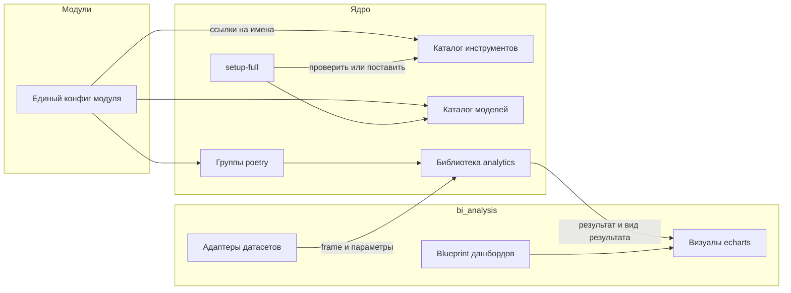

# Аудит модуля bi_analysis и план развития аналитики

> Исторический аудит ревизии `5cc918d`. Выводы ниже сохранены как исходный план,
> а не описание текущего кода. Состояние на 21.10.2026: основа A и адаптеры
> инструментов оформлены локальными коммитами; большой diff BI сохранён отдельно
> в рабочей копии. Реестр серии и проверок — [local-residual-status.md](local-residual-status.md).
> Полная установка с нуля и повторный setup Windows/Linux ещё не подтверждены.
> Следующий порядок остаётся B/C → D → F/G → E → H. Доступен только PostgreSQL;
> MSSQL и ClickHouse не проверены. Коммит 201330bc не восстанавливается.

Документ описывает состояние модуля `modules/bi_analysis` на коммите `5cc918d` (ветка `dev`), показывает, что в нём расходится с правилами платформы, и предлагает порядок работ: вынести аналитическую математику, зависимости, каталог инструментов и каталог моделей в ядро, оставить в BI визуалы и заложить автоматическую сборку дашбордов.

Это не журнал изменений и не описание сделанного. Код при подготовке документа не менялся. Единственное действие в репозитории: локально инициализирован submodule `modules/bi_analysis`, указатель в обёртке остался прежним.

## Что учтено и что нет

Запрос содержал пять требований:

1. Развивать существующие дашборды: их формирование и другие возможности.
2. Вынести в ядро аналитическую библиотеку со всеми нужными инструментами, чтобы сократить зависимости модулей.
3. Заложить автоматическую сборку дашбордов.
4. Считать на polars в ядре, а качественные графики и визуалы строить в BI на echarts.
5. Прочитать бэклог, перенести пакеты в ядро (модуль лишь указывает, что ему нужно) и продумать сущность tools.

Бэклог состоит из трёх карточек проекта `ergoms/projects/2`. Сами карточки приватные и мне недоступны. Их текст я получил от пользователя в чате, поэтому ссылки на заголовки ниже даны по этому тексту:

- вынести инструментальные модули в индексированную базу ядра и ставить их при необходимости интеграции модулей (`ai_assistant`, `bi`, `ollama_framework`);
- сформировать в ядре базу инструментов (LibreOffice, ffmpeg, ollama и другие) со скриптами подкачки и зеркалами, устанавливать в `packages`, в модуле держать один конфиг используемых инструментов, а `setup full` должен ставить или проверять каждый из них;
- сформировать в ядре базу моделей (Hugging Face и другие) и файл конфига с подкачкой через `setup full` по аналогии с базой инструментов.

Модуль `ai_assistant` в рабочей копии не загружен, поэтому его потребности в инструментах и моделях не проверены. Это первое, что надо сделать перед этапом A.

### Какое требование в каком этапе закрывается

| Требование | Этапы |
|---|---|
| 1. Развитие существующих дашбордов, их формирования и возможностей | F, G, частично E |
| 2. Аналитическая библиотека в ядре, меньше зависимостей модулей | C, D |
| 3. Автоматическая сборка дашбордов | E (нужен F) |
| 4. Расчёты на polars в ядре, визуалы на echarts в BI | C, D, G |
| 5. Пакеты в ядро, модуль указывает нужное, сущность tools | A, B, C, D |
| Бэклог: инструментальные модули в базу ядра, доустановка по интеграции | A |
| Бэклог: база инструментов со скриптами подкачки и зеркалами, единый конфиг, `setup full` | A |
| Бэклог: база моделей и конфиг подкачки через `setup full` | B |
| Находки аудита по безопасности и правилам платформы | 0 |

## Состояние модуля

Размер: 559 файлов в git. Серверная часть разбита на приложения `bi_connections`, `bi_datasets`, `bi_charts`, `bi_dashboards`, `sharing`, `recommender`, `eda`, `modeling`, `sandbox`. Клиент: страницы подключений, датасетов (включая вкладку анализа), графиков, дашбордов и редактор таблиц.

Наружу модуль даёт мост (`api/integrations.py`): группу `bi.data_source` и операции `bi.ensure_module_connection`, `bi.upsert_module_connection_file`, `bi.get_module_connection_file`, `bi.delete_module_connection_file`, `bi.delete_module_connection_artifacts`, а также лимит загрузок в media_api. На клиенте мост (`client/js/integrations.js`) отдаёт встраиваемые компоненты графиков, создание и поиск датасетов.

Поведение, которое уже зафиксировано, лежит в `BEHAVIOR.md`: поведение виджетов дашборда, правила диаграмм, рекомендации по датасету, баннер изменений файлов.

### Где сейчас считается аналитика

Математика размазана по четырём местам:

| Что считается | Где | Чем |
|---|---|---|
| Сводка, распределения, корреляции, выбросы | `api/eda/engine.py` | polars |
| Линейная регрессия, ARIMA, SARIMA, boxplot | `api/modeling/engine.py` | statsmodels, numpy, polars |
| Статистика полей для рекомендаций | `api/recommender/profile.py` | SQL-агрегаты или polars |
| Агрегация рядов графика | `api/bi_charts/methods.py` | SQL в PostgreSQL |
| Агрегация графика по одному файлу | `api/bi_charts/file_rows.py` | циклы Python |
| Свёртка и фильтры рядов под тип графика | `client/Charts/components/js/chartDataTransform.js` | JavaScript, 759 строк |
| Соединение файлов | `api/bi_datasets/services/draft_preview/file_join_polars.py` | polars |
| Сходство текстов | `api/sandbox/service.py` | sentence-transformers, torch |

Агрегация графика реализована тремя отдельными движками. Совпадают ли их результаты на граничных случаях (пустые значения, даты, бины), я не проверял, поэтому перед удалением любого из них нужна сверка на одном датасете. Это главный источник рисков при любых изменениях в расчётах.

### Где живут зависимости

Ядро объявляет в корневом `pyproject.toml` только `pandas` и `numpy` из аналитики. Всё остальное приходит из модулей:

- `bi_analysis`: polars, pyarrow, fastexcel, openpyxl, statsmodels, sentence-transformers, torchvision.
- `competence_core`: torch, sentence-transformers, scikit-learn, pyarrow.
- `education_materials_parser`: torch, sentence-transformers, sentencepiece, pyarrow.
- `ollama_framework`: sentence-transformers.

Установщик (`core/api/commands/install.py`) ставит ядро через poetry, затем собирает зависимости всех `modules/*/pyproject.toml` и доустанавливает их отдельным слоем pip с ограничениями из `poetry.lock` ядра. `pyarrow` объявлен тремя модулями с разными границами версий. `echarts` и `vue-echarts` тянут шесть модулей: `bi_analysis`, `crm_remastered`, `competence_core`, `vacancies_parser`, `education_materials_parser`, `learning_analytics`.

### Инструменты и модели

Установка portable-инструментов в `virtual_env/packages` уже работает: реестр ядра (`core/deployment/packages/core_packages.yaml`) плюс `modules/<имя>/packages.yaml`. Снимки Hugging Face ставит шаг `PullHuggingfaceModelsStep` по `huggingface_models.yaml`, модели Ollama описаны в `ollama_models.yaml`.

Но владелец каждого инструмента остаётся модулем:

- LibreOffice описан и ставится из `modules/crm` (`deployment/install_libreoffice.py`).
- ollama ставится из `modules/ollama_framework`.
- tesseract ставится из `modules/education_materials_parser`.
- chrome-for-testing ставится из `modules/vacancies_parser`.

У каждого свой скрипт, свои URL, нет общего индекса и зеркал. Модуль, которому нужен тот же инструмент, не может взять его по имени, не зная модуль-владельца.

## Находки аудита

Серьёзность: высокая означает нарушение правил безопасности платформы или риск потери данных, средняя означает нарушение правил кода или архитектуры, низкая означает гигиену.

### Безопасность и правила платформы

**Высокая. Чужой отчёт по `task_id`.** В `api/eda/views.py` (`EdaStatusView`) и `api/modeling/views.py` (`ModelingStatusView`) отчёт ищется как `EdaReport.objects.filter(task_id=task_id)` и `AnalysisReport.objects.filter(task_id=task_id)`. Права проверяются на датасет из URL, а отчёт берётся без привязки к нему. Пользователь с доступом к любому датасету может получить результат чужого анализа, если знает `task_id`.

**Высокая. Статус задачи песочницы не привязан к владельцу.** `SandboxSimilarityStatusView` отдаёт состояние, прогресс и текст ошибки любой задачи по `task_id`. Проверка владельца есть только при выдаче результата.

**Высокая. Числовые идентификаторы наружу.** Правила платформы требуют внешних `public_id`. Ответы запуска EDA и моделирования возвращают `report_id: report.pk`. Сериализаторы дашборда отдают числовые `id` и `owner_id`. У моделей `EdaReport`, `AnalysisReport`, `DatasetProfile` нет `public_id`.

**Средняя. Тексты исключений в ответах.** Встречаются `str(exc)` и `str(task.info)` в ответах EDA, моделирования и песочницы, а в `EdaDashboardBuildView` ещё и в формате `Ошибка при сборке дашборда: {exc}`. Детали надо писать в лог, клиенту отдавать общий текст.

**Средняя. Базовые классы ядра не используются.** Поиск по модулю не нашёл ни `BaseAPIView`, ни `BaseModelViewSet`, ни `PublicIdMixin`, ни `AuditedModelMixin`. Вьюхи собраны из `APIView`, `generics.*` и `SwaggerSafeMixin`. Аудит CRUD дашбордов, графиков и датасетов не подключён.

### Архитектура и зависимости

**Средняя. Один и тот же расчёт в трёх движках** (SQL, циклы Python, JavaScript), описано выше.

**Средняя. Зависимости модуля тянут аналитику в окружение ядра в обход его `poetry.lock`.** `pyarrow` и `sentence-transformers` объявляются в нескольких модулях. `torchvision==0.25.0` не импортируется нигде в модуле, а модули `competence_core` и `education_materials_parser` фиксируют `torch==2.11.0+cu130`. По соответствию версий PyTorch и torchvision пара `torchvision 0.25` и `torch 2.11` не совместима. Это стоит проверить установкой, прежде чем удалять пин. Сообщение в `api/sandbox/service.py` само просит проверить совместимость torch и torchvision.

**Средняя. Много доменной логики чужого предметного слоя.** В `api/sandbox/service.py` и в клиентской странице песочницы зашита сверка фамилий преподавателей (`_teacher_keys`, `_group_by_teacher`). Это предметный слой, а не общий инструмент BI. В комментариях `client/js/integrations.js` упомянуты чужие модули и их данные.

**Средняя. Файл длиннее 700 строк.** `client/Charts/components/js/echartsOptionBuilder.js` содержит 1304 строки при потолке 700 из `code.mdc`.

**Низкая. Мёртвый код и лишние зависимости.**

- `chart.js` и `vue-chartjs` объявлены в `client/package.json`, но `client/js/registerChartJs.js` нигде не импортируется.
- В `api/config.py` функция `get_compute_device` и константа `USE_GPU` нигде не используются.
- `task_footprint.yaml` помечает `gpu_required: true` все задачи модуля, включая очистку и пересинхронизацию, хотя GPU нужен только песочнице.
- `EDA_SAMPLE_LIMIT` задан дважды: в `api/config.py` и жёстко в `api/eda/data_loader.py`, второй читается вместо первого.
- Функция `_is_task_alive`, набор числовых типов polars и логика статуса задачи продублированы в EDA и моделировании.
- Переменные `BI_ANALYSIS_EDA_*`, `BI_ANALYSIS_MODELING_*`, `BI_ANALYSIS_SANDBOX_*`, `BI_ANALYSIS_USE_GPU`, `BI_ANALYSIS_CHUNK_SIZE`, `BI_ANALYSIS_MAX_WORKERS`, `BI_ANALYSIS_PREVIEW_LIMIT` читаются в коде, но не описаны в `.env.example` и README.

**Низкая. Расход памяти в EDA.** `load_dataset_as_polars_df` читает файл или выгрузку из БД целиком и только затем делает `sample`. Для больших источников выгоднее ограничивать чтение до выборки.

**Низкая. Нет локализации клиента и правил Cursor.** В `client/` нет `locales.js`, русские строки зашиты в компоненты. В модуле нет `.cursor/rules`.

### Дашборды

- `DashboardWriteSerializer.update` удаляет все страницы и элементы дашборда и создаёт их заново. Идентификаторы виджетов нестабильны. Поэтому автосборка по EDA хранит ключи в JSON (`config['eda_key']`, `options['eda_key']`) и вынуждена пересобирать элементы целиком.
- Тип виджета хранится русской строкой (`'Заголовок'`, `'Текст'`, `'График'`, `'Селектор'`), то есть значение интерфейса попало в данные.
- `Dashboard.charts_count` считается в Python обходом страниц и элементов для каждой записи списка.
- API дашбордов даёт только создание, чтение, обновление и удаление. Поиск по `api/bi_dashboards` и `client/Dashboards` не нашёл клонирования, шаблонов, экспорта и истории версий. В `api/bi_charts` нет обращений к кэшу: ряды графика считаются заново на каждый запрос. Кэш есть только у чтения файлов (`api/bi_datasets/services/file_io.py`) и у части рекомендаций (`api/recommender/dataset/features.py`).
- Автосборка существует только для EDA (`api/eda/dashboard_builder.py`, 674 строки). В ней смешаны спецификации виджетов, раскладка и запись в БД.

### Тесты

В модуле 11 тестовых файлов: профиль датасета, утилиты таблиц, контракты соединений, редактор, чтение Excel, подключения модулей. Тестов на `eda`, `modeling`, `bi_dashboards`, `bi_charts`, `sharing`, `sandbox`, сборку дашборда по EDA нет. Запуск тестов в рамках аудита не проводился.

## Что считать целевым состоянием

### Принципы

- Ядро владеет вычислениями, зависимостями, каталогом инструментов и каталогом моделей. Оно не знает датасеты BI и не пишет имён установленных модулей.
- BI владеет визуалами (echarts), сборкой дашбордов и работой пользователя с датасетами и графиками.
- Модуль объявляет, что ему нужно, одним конфигом со ссылками на имена из индексов ядра. Установщик и `setup-full` проверяют наличие и ставят недостающее.
- Связь модуль и ядро идёт через ModuleBridge и hook-файлы с фиксированным именем, не через импорты.

### Три индекса ядра

1. **Каталог инструментов.** Записи: `libreoffice`, `ffmpeg`, `ollama`, `tesseract`, `chrome-for-testing` и далее. Для каждой: версия, платформы, упорядоченный список зеркал, проверка целостности, маркер установки, скрипт подкачки. Живёт рядом с `core_packages.yaml` и использует существующий установщик пакетов.
2. **Каталог моделей.** Записи для Hugging Face и Ollama: идентификатор, назначение (эмбеддинги, LLM, распознавание), размер, зеркала, проверка. Строится по образцу каталога инструментов и поверх существующих `core/deployment/huggingface/` и `huggingface_snapshot.py`.
3. **Аналитическая библиотека `core.analytics`.** Чистый Python на polars без Django-моделей: чтение таблиц, статистика, модели, агрегация, профиль полей, сходство текстов.

Python-зависимости аналитики оформляются как группы poetry в корневом `pyproject.toml`: `analytics` (polars, pyarrow, fastexcel, openpyxl, statsmodels) и `analytics-ml` (sentence-transformers). Версии решаются один раз в `poetry.lock`. Модуль называет нужные группы, установщик добавляет их к `--with` и учитывает в отпечатке зависимостей.

### Единый конфиг модуля

Один файл в корне модуля, где перечислены нужные записи из индексов: инструменты, модели, группы Python-зависимостей, условия (`required`, включение интеграции). Старые `packages.yaml`, `huggingface_models.yaml`, `ollama_models.yaml` продолжают читаться, пока модули не перейдут. Точное имя файла и формат выбираются при реализации, их надо согласовать с правилом `packages.mdc`.

### Аналитические операции

Чтобы не путать с каталогом инструментов, функции аналитики называются здесь операциями. Операция описывается дескриптором: идентификатор, название, категория, схема входа и выхода, подсказка вида результата (таблица, гистограмма, матрица, ряд, прогноз, boxplot), нужная группа зависимостей, footprint и функция запуска, принимающая `polars.DataFrame`, параметры и колбэк прогресса.

Реестр лежит в ядре, модули добавляют операции через hook-файл. В каталог платформенных контрактов добавляются имена `core.analytics.list_tools` и `core.analytics.run_tool` (константы, затем реализация). Запуски хранятся одной моделью с `public_id`, статусом, прогрессом и результатом вместо пары `EdaReport` и `AnalysisReport`.

В BI экран операции строит форму из схемы входа и показывает результат компонентами BI по подсказке вида результата. Рекомендатор графиков остаётся в BI, он про визуалы.

### Автоматическая сборка дашбордов

- `DashboardBlueprint`: декларативное описание дашборда (виджеты, подсказки раскладки), не зависящее от источника.
- `BlueprintApplier`: идемпотентное применение по стабильному ключу `blueprint_key`, хранимому колонкой. Виджет, который пользователь правил вручную, помечается и не перезаписывается.
- Композеры по ключу: `eda`, `profile` (по правилам `chart_grammar`) и точка расширения для модулей через группу моста.
- Триггеры: окончание пересинхронизации датасета, готовность профиля, расписание Celery Beat, ручной запуск. Флаг автосборки на датасете. Уведомление владельцу через мост ядра.

Предпосылка: обновление дашборда должно сопоставлять виджеты по `public_id`, а не пересоздавать их.

## Порядок работ

| Этап | Содержание | Зависит от |
|---|---|---|
| 0 | Закрыть доступ к отчётам по `task_id`, убрать числовые id и тексты исключений, `public_id` для отчётов и профиля, базовые классы ядра, аудит CRUD, убрать мёртвый код, исправить footprint, описать env | нет |
| A | Каталог инструментов ядра, перенос скриптов подкачки из модулей, единый конфиг модуля, проверка и установка в `setup-full`, доустановка при включении интеграции | загрузка `ai_assistant` |
| B | Каталог моделей ядра и подкачка через `setup-full` по единому конфигу | A |
| C | Библиотека `core.analytics`, группы poetry, чтение групп модуля в установщике | A |
| D | Реестр операций, контракты, единая задача и модель запуска, экран в BI | C |
| E | Blueprint и автосборка дашбордов | D, F |
| F | Обновление дашбордов без пересоздания, коды типов виджетов, клонирование, экспорт, версии, кэш рядов, `charts_count` | нет |
| G | Разрезать `echartsOptionBuilder.js`, перенести агрегацию на сервер, `locales.js`, правила Cursor модуля | C |
| H | Документация модуля и правил ядра, тесты, проверки | все |

Этапы A и B можно вести параллельно с этапом 0. Этап F стоит начать раньше E: сборка по ключам без стабильных идентификаторов виджетов останется хрупкой.

### Что входит в этап и когда он закончен

**Этап 0.** Правки в `eda/views.py`, `modeling/views.py`, `sandbox/views.py`, `models.py`, `bi_dashboards/serializers.py`, `config.py`, `task_footprint.yaml`, `pyproject.toml` и `client/package.json` модуля. Закончен, когда отчёт доступен только через датасет из URL, в ответах нет числовых id и текстов исключений, у `EdaReport`, `AnalysisReport`, `DatasetProfile` есть `public_id` с миграцией, вьюхи стоят на базовых классах ядра, а `ergoms core-rules-check` и `ergoms api test` проходят.

**Этап A.** Загрузить `ai_assistant` и выписать его потребности. Описать записи каталога инструментов, перенести скрипты подкачки из `crm`, `ollama_framework`, `education_materials_parser`, `vacancies_parser` в ядро, ввести единый конфиг модуля, добавить в `setup-full` шаг проверки и установки, добавить доустановку при включении интеграции. Закончен, когда на чистой машине `ergoms setup-full` ставит все указанные модулем инструменты по записям каталога, при недоступном зеркале берёт следующее, а `ergoms system-test` проходит.

**Этап B.** Записи каталога моделей, перевод `PullHuggingfaceModelsStep` и `pull-setup-models` на каталог. Закончен, когда необходимые модели скачиваются по единому конфигу, уже лежащий снимок не качается повторно, рантайм получает путь через `resolve_huggingface_source` или `ensure_local_source`.

**Этап C.** Пакет `core.analytics` с подпакетами `frame`, `stats`, `models`, `aggregate`, `profile`, `similarity`, группы poetry `analytics` и `analytics-ml`, чтение групп модуля в установщике, удаление аналитики из `pyproject.toml` модуля. Закончен, когда `bi_analysis` вызывает библиотеку ядра, результаты на контрольном датасете совпадают со старыми, версии polars, pyarrow, statsmodels и torch определены только в `poetry.lock` ядра.

**Этап D.** Дескриптор и реестр операций, контракты `core.analytics.*`, единая задача и модель запуска, экран в BI, миграция старых отчётов или решение оставить их архивом. Закончен, когда EDA, моделирование и boxplot запускаются как операции из реестра, а `Datasets/Analysis/*` рисует результат по виду результата.

**Этап E.** `DashboardBlueprint`, `BlueprintApplier`, композеры `eda` и `profile`, триггеры, флаг автосборки. Закончен, когда повторная сборка не затирает правки пользователя, меняет только свои виджеты по `blueprint_key`, а сборка после пересинхронизации датасета запускается сама.

**Этап F.** Обновление дашборда с сопоставлением по `public_id` виджета, коды типов виджетов вместо русских строк, клонирование, шаблоны, экспорт PNG и PDF (офисные форматы через каталог инструментов), история версий, серверный кэш рядов графика с инвалидацией по синхронизации датасета, исправление `charts_count`. Закончен, когда сохранение дашборда не меняет идентификаторы нетронутых виджетов, а повторный запрос ряда графика без изменений датасета не идёт в источник.

**Этап G.** Разрезать `echartsOptionBuilder.js` на файлы не длиннее 700 строк по типам графиков, вынести агрегацию рядов на сервер (`core.analytics.aggregate`), добавить `client/js/locales.js` и правила `.cursor/rules` модуля. Закончен, когда `chartDataTransform.js` не считает агрегаты, а `BEHAVIOR.md` не нарушен (поведение виджетов и диаграмм сохраняется).

**Этап H.** Обновить `AGENTS.md`, `README.md`, `BEHAVIOR.md` модуля, правила `packages.mdc`, `huggingface-models.mdc` и каталог контрактов, написать недостающие тесты. Закончен, когда все проверки из раздела ниже проходят.

### Что в этот документ не вошло

- Оценка трудоёмкости и сроки: без текста карточек и без ответа, кто и сколько на это выделит, я их не даю.
- Отдельная ветка про остальные модули с собственным `echarts`: сведение копий к одной вынесено в риски.
- Нагрузочные измерения: время и память EDA, агрегации и экспорта не измерялись, цифры производительности в документе только по чтению кода.

## Проверка результата

После каждого этапа:

- `ergoms core-rules-check` для изоляции ядра и модулей.
- `ergoms api test` для тестов модуля и ядра.
- `ergoms system-test` для любых правок установщика, `setup-full`, `commands.conf` и развёртывания.
- Для каталогов: проверка разбора конфига, перебора зеркал, маркера установки и поведения при недоступном зеркале.
- Для расчётов: сравнение результатов старых и новых движков на одном датасете, прежде чем удалять старые.

## Риски и открытые вопросы

- **Бэклог прочитан по пересказу.** Текст трёх карточек пришёл из чата. После доступа к проекту надо сверить формулировки, статусы и комментарии, а приоритеты этапов пересмотреть.
- **Смысл слова tools.** В бэклоге это portable-инструменты. В исходном запросе «сущность tools» стоит рядом с «bi позволяет на фронте работать с этим». Документ закладывает оба понимания: каталог инструментов в ядре и аналитические операции с экраном в BI. Если нужна только одна из них, этапы D и A можно сузить.
- **Совместимость torch и torchvision** предполагается по таблице соответствия версий и не проверена установкой.
- **Миграция отчётов.** Переход от `EdaReport` и `AnalysisReport` к единой модели запуска требует миграции данных. Нужно решить, переносить ли старые результаты или оставить их как архив.
- **Типы виджетов дашборда.** Замена русских значений кодами меняет данные в БД и формат ответов API. Клиент и миграцию надо выкатывать вместе.
- **echarts в других модулях.** Пять модулей кроме BI тянут свои копии библиотеки. Этот документ их не трогает. Сведение к одной копии (через мост BI или через клиент ядра) стоит рассмотреть отдельно.
- **Не загруженные модули.** `ai_assistant`, `video_analysis`, `neural_networks_hub`, `porosity_analysis` и ещё несколько модулей в рабочей копии пустые. Их потребности в ffmpeg, моделях и аналитике не учтены, каталоги могут получить дополнительные записи после загрузки.

## Связанные документы

- [`architecture.md`](architecture.md) и [`modules.md`](modules.md) описывают границы ядра и модулей.
- [`modularization.md`](modularization.md) описывает вынос процесса и схему данных модуля.
- [`lifecycle-pipeline.md`](lifecycle-pipeline.md) описывает шаги `setup-full`.
- Правила агента: `packages.mdc`, `huggingface-models.mdc`, `module-contracts-catalog.mdc`, `celery-balance.mdc`.
